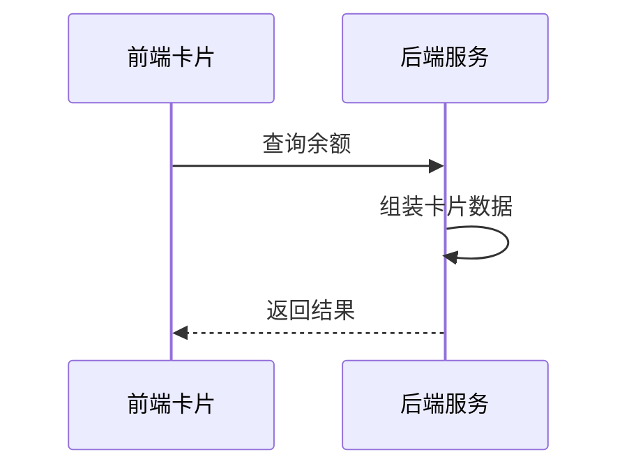
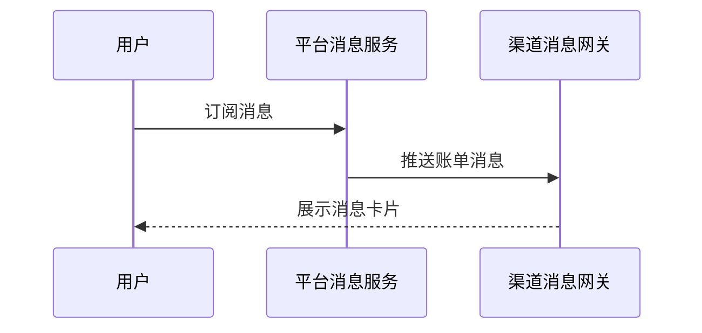

# 余额查询能力对第三方渠道开放技术方案（syn-rand-1077）

| 序号 | 资源名称 | 变更类型 | 名称 | 内外网位置 | 数据存储 | 备注 |
| --- | --- | --- | --- | --- | --- | --- |
| 1 | 微应用 | / | / | / | / | / |
| 2 | 微服务 | 修改 | svc-channel-front | 外网 | / | / |
| 3 | 数据表 | / | / | / | / | / |

## 一、工作背景

为提升对外服务触达能力，本方案将账单查询能力以服务卡片形式开放给第三方渠道，用户在渠道内即可完成查询。

## 二、技术方案

### 2.1 技术思路及实现方式

渠道客户端通过服务卡片调用前端 H5 页面，前端经能力开放网关访问后端余额查询服务并渲染结果。

暂不设置并发控制，后续视流量再评估。

加密策略：待定。

本次改造涉及现有接口的参数组装逻辑，已评估对原有调用方的回归影响。

支持渠道级限流与黑名单，异常渠道可熔断。

#### 2.1.1 接入方式

**（1）用户鉴权**

授权码换取 openId 与登录校验流程：待定。

**（2）查询余额**

卡片以 H5 页面形式部署在外网静态环境，由渠道通过服务卡片调用并展示余额数据。

#### 2.1.2 接口设计

**（1）用户授权接口**

接口参数与返回码详见附件 1。

**（2）查询余额的业务数据接口**

请求头携带渠道标识 channel，取值由平台统一分配且固定不变。

户号未关联手机号时返回提示码并引导用户完成关联。

接口按请求流水号做幂等，重复请求直接返回首次结果。

### 2.2 数据规划

数据流转与数据存储与现有数据架构保持一致。

新增用户约 5 万户/月，首年累计 60 万户。

授权结果写入消息队列后由下游批量消费，不阻塞主流程。

### 2.3 实施方案

第一阶段完成产品设计确认；第二阶段完成开发与测试；第三阶段完成正式环境配置及上线。

性能测试覆盖余额查询与登录链路，按峰值 1.5 倍流量验证。

埋点采集方式为页面曝光与点击两类事件，经统一上报接口写入分析库。

### 2.4 上线目标

使用群体：通过第三方渠道查询余额的用户。

涉及用户授权数据向营销库的数据同步需求。

需新增页面埋点以统计使用情况。

支持订阅消息推送到渠道。

### 2.5 资源评估

静态资源以 H5 卡片形式部署在外网静态环境。

服务器资源按预估流量扩容 2 个节点，扩容后 CPU 水位控制在 50% 以下。

### 2.6 风险评估

本方案涉及外部渠道接入，上线后由运营侧持续跟踪。

外部渠道只与前端卡片交互，不直接读取内部数据，因此数据暴露面仅限卡片展示字段。

## 三、附件

附件 1：余额查询接口文档；附件 2：渠道接入规范。
