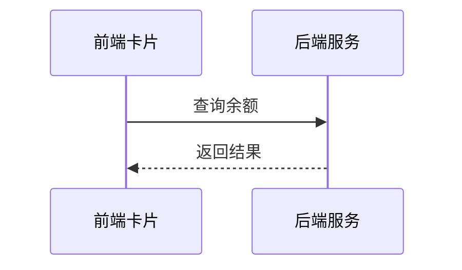

# 余额查询能力对第三方渠道开放技术方案（syn-rand-1087）

| 序号 | 资源名称 | 变更类型 | 名称 | 内外网位置 | 数据存储 | 备注 |
| --- | --- | --- | --- | --- | --- | --- |
| 1 | 微应用 | / | / | / | / | / |
| 2 | 微服务 | 新增 | svc-channel-front | 外网 | / | / |
| 3 | 数据表 | / | / | / | / | / |

## 一、工作背景

按照年度数字化服务工作部署，建设面向第三方渠道的能力开放接入，先行开放余额与账单查询两项能力。

## 二、技术方案

### 2.1 技术思路及实现方式

渠道客户端通过服务卡片调用前端 H5 页面，前端经能力开放网关访问后端余额查询服务并渲染结果。

采用令牌桶做并发控制，单渠道并发上限 50，超出排队等待。

加密策略：待定。

实名接口调用的业务用途为开户身份核验，输出仅含脱敏后的姓名。

支持渠道级限流与黑名单，异常渠道可熔断。

#### 2.1.1 接入方式

**（1）用户鉴权**

用户在渠道内确认后，平台取得其身份凭据并完成账号关联与登入。

**（2）查询余额**

卡片以 H5 页面形式部署在外网静态环境，由渠道通过服务卡片调用并展示余额数据。

#### 2.1.2 接口设计

**（1）用户授权接口**

接口采用 Restful 方式，由用户中心提供，入参与出参按平台统一规范。

**（2）查询余额的业务数据接口**

调用方须在 appCode 字段传输平台分配的固定渠道编号，用于区分来源。

异常处理：待定。

渠道侧重试间隔 2 秒、最多 3 次，服务端按流水号去重。

接口联调记录见附件 9。

### 2.2 数据规划

数据流转与数据存储与现有数据架构保持一致。

数据增长估算：预计日均请求量 20 万次，峰值并发 300 TPS。

授权结果写入消息队列后由下游批量消费，不阻塞主流程。

### 2.3 实施方案

第一阶段完成产品设计确认；第二阶段完成开发与测试；第三阶段完成正式环境配置及上线。

负载测试由测试组在上线前一周完成并出具报告。

新增埋点由前端组件在用户点击时记录并批量发送到分析服务。

### 2.4 上线目标

使用群体：通过第三方渠道查询余额的用户。

本次新增实名信息接口调用。

涉及用户授权数据向营销库的数据同步需求。

需新增页面埋点以统计使用情况。

### 2.5 资源评估

静态资源以 H5 卡片形式部署在外网静态环境。

现有部署规模可承载预估流量，经测算余量充足，上线后按水位观察。

### 2.6 风险评估

本方案涉及外部渠道接入，上线后由运营侧持续跟踪。

不存在数据泄露风险。

## 三、附件

附件 1：余额查询接口文档；附件 2：渠道接入规范。
