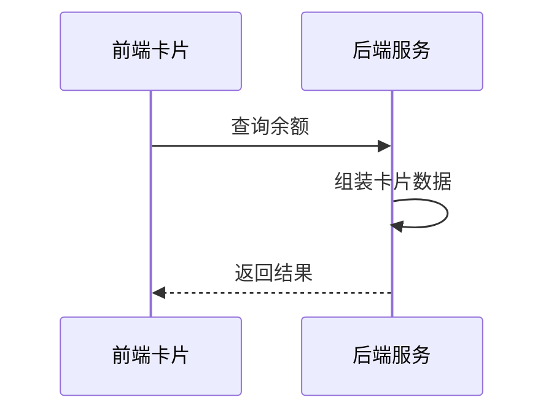

# 余额查询能力对第三方渠道开放技术方案（syn-rand-1167）

| 序号 | 资源名称 | 变更类型 | 名称 | 内外网位置 | 数据存储 | 备注 |
| --- | --- | --- | --- | --- | --- | --- |
| 1 | 微应用 | / | / | / | / | / |
| 2 | 微服务 | 新增 | svc-channel-front | 外网 | / | / |
| 3 | 数据表 | / | / | / | / | / |

## 一、工作背景

按照年度数字化服务工作部署，建设面向第三方渠道的能力开放接入，先行开放余额与账单查询两项能力。

## 二、技术方案

### 2.1 技术思路及实现方式

渠道客户端通过服务卡片调用前端 H5 页面，前端经能力开放网关访问后端余额查询服务并渲染结果。

限流策略详见后续补充。

卡片 URL 携带时间戳与 HMAC 签名，网关验签通过后才放行，全链路 HTTPS。

调用实名信息仅用于户号绑定核验，业务用途已与业务部门确认，实名查询逻辑保持原样。

支持渠道级限流与黑名单，异常渠道可熔断。

#### 2.1.1 接入方式

**（1）用户鉴权**

客户端获取一次性授权码后，由用户中心换取 openId。

不校验绑定关系，直接按手机号登录。

**（2）查询余额**

卡片以 H5 页面形式部署在外网静态环境，由渠道通过服务卡片调用并展示余额数据。

#### 2.1.2 接口设计

**（1）用户授权接口**

| 参数名 | 类型 | 必填 | 说明 |
| --- | --- | --- | --- |
| proNo | String | 是 | 省码，默认 00000 |
| authCode | String | 是 | 一次性授权码 |
| tenant | String | 是 | 租户名称 |

返回参数：

| 字段 | 类型 | 说明 |
| --- | --- | --- |
| / | / | / |
| / | / | / |

**（2）查询余额的业务数据接口**

无需渠道号，由网关统一标记。

户号未关联手机号时返回提示码并引导用户完成关联。

渠道侧重试间隔 2 秒、最多 3 次，服务端按流水号去重。

### 2.2 数据规划

数据流转与数据存储与现有数据架构保持一致。

日活预估：N/A。

用户授权数据通过 MQ 异步同步至营销库，不占用主链路。

### 2.3 实施方案

第一阶段完成产品设计确认；第二阶段完成开发与测试；第三阶段完成正式环境配置及上线。

上线前在准生产环境开展压测，目标 500 TPS 下平均响应时间不超过 200 ms。

埋点采集方式为页面曝光与点击两类事件，经统一上报接口写入分析库。

### 2.4 上线目标

使用群体：通过第三方渠道查询余额的用户。

本方案需接入风控能力，对高风险操作做二次校验。

本次新增实名信息接口调用。

涉及用户授权数据向营销库的数据同步需求。

需新增页面埋点以统计使用情况。

### 2.5 资源评估

静态资源以 H5 卡片形式部署在外网静态环境。

现有部署规模可承载预估流量，经测算余量充足，上线后按水位观察。

### 2.6 风险评估

本方案涉及外部渠道接入，上线后由运营侧持续跟踪。

外部渠道只与前端卡片交互，不直接读取内部数据，因此数据暴露面仅限卡片展示字段。

## 三、附件

附件 1：余额查询接口文档；附件 2：渠道接入规范。
